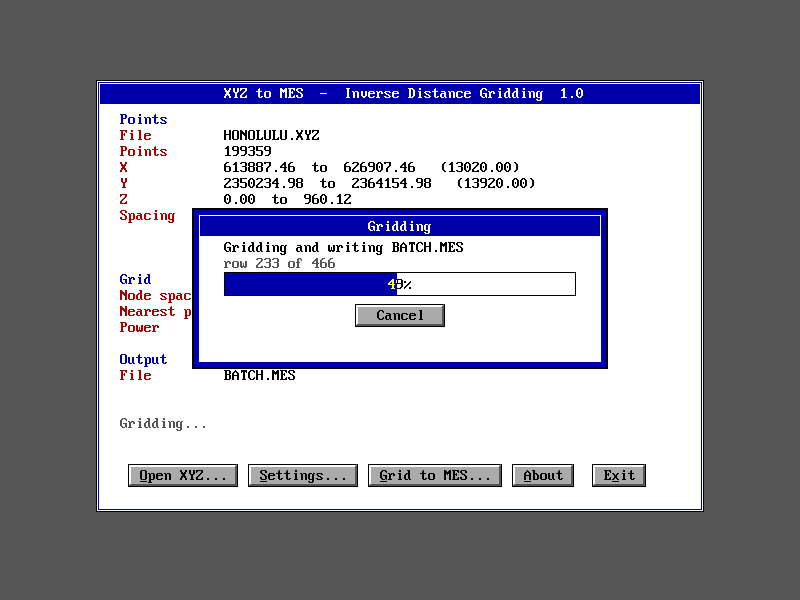

# DiskArray

Arrays stored on disk, used with normal C++ array syntax, for systems with little RAM and no MMU, such as MS-DOS on an 8086.

```cpp
#include "dskarray.h"

DiskArray2<float> grid("grid.tmp", 1000, 1000);   // instead of float grid[1000][1000];
DiskArray<double> v("v.tmp", 100000L);            // instead of double v[100000];

grid[x][y] = grid[x - 1][y] + 1;                  // the rest of the code doesn't change
v[i] *= 2;
```

On a system with an MMU, virtual memory already does this for you, so use that instead. This library is for machines where nothing can catch a memory access, so the array has to do the work itself. It needs no EMS, XMS or other hardware beyond a disk.

**From 3 days to 3 minutes:** on an emulated 286, gridding 60,000 scattered points to a 100×100 grid took 2 min 46 s using this library's disk arrays and bucketing. Searching every point for every grid node would take about 3 days by estimate.

## How it works

The idea comes from Rubtsov Grigorii's 1997 freeware `disk_arr`, which proved that a C++ class can make a file look like an array. That design read the disk once per element. This is a new implementation with a cache:

- A pool of 4 KB pages in memory, shared by all arrays, keeps the most recently used data. Changed pages are written back when they leave the pool.
- A hash table finds cached pages quickly, and staying on the same page takes a single comparison.
- 2D arrays are stored in square tiles, so neighbors in either direction usually share a page.
- Element access goes through a small proxy object, so the page is looked up at the moment of each read or write.

## Using it

Add `dskarray.cpp` to your project and include `dskarray.h`. It's plain C++98 with no other dependencies.

```cpp
da_cache_init(32);                                // optional: pool size in pages, 32 by default

DiskArray2<float> a("a.tmp", 300, 200);           // deleted when it goes out of scope
DiskArray2<float> b("b.dat", 300, 200, 0.0f, 1);  // kept, and reopened with its contents
```

Structs work too, and keeping all of a record's fields in one struct usually beats using separate arrays:

```cpp
struct Point { float x, y, z; };

DiskArray<Point> pts("pts.tmp", 60000L);
Point p = pts[i];
pts[i] = p;
```

Define `DA_CHECK` to stop with an error on an out-of-range index.

### What isn't transparent

- Elements are proxies, so varargs need a cast: `printf("%f", (double)(float)a[x][y]);`
- `a[i].member` doesn't work: copy the struct out, change it and assign it back.
- You can't take a pointer to an element.
- Each array is a file, so it uses a DOS file handle. Check `if (!a)` after opening.
- Very thin 2D arrays, such as N×4, waste space because tiles are square. Use a 1D array of structs instead.

### Limits

- About 2 GB per array, from signed 32-bit file offsets, and whatever the file system allows. DOS FAT16 partitions stop at about 2 GB.
- Each side of a `DiskArray2` is limited by `unsigned`, which is 65,536 elements on a 16-bit compiler.
- 256 pages in the pool, and an element can be at most 4096 bytes.
- Array files use the machine's own byte order and struct layout, so they aren't portable between systems.

## Results

These are from DOSBox-X emulating a 286 at fixed 3000 cycles, built with Open Watcom in large model. Reads per second on a 200×200 float array:

| Pattern | Plain RAM | Old method (seek per element) | DiskArray, 64 pages (256 KB) |
|---|---|---|---|
| Rows | 242,424 | 5,602 | 56,022 |
| Columns | 242,424 | 5,602 | 60,698 |
| Nearby | 14,864 | 4,049 | 13,004 |
| Random | 15,835 | 4,044 | 8,669 |

The Nearby and Random RAM rates are lower mainly because those tests spend most of their time computing the next position.

Inverse-distance gridding, where each node uses its 6 nearest points:

| Job | All-points search | With buckets (`idwb`) |
|---|---|---|
| 1,200 points, 20×20 | 21.7 s | 1.4 s |
| 60,000 points, 100×100 | about 3 days (estimated) | 2 min 46 s (measured) |

In the 60,000-point run, 111 s went to sorting points into cells, because random cells defeat the cache. A 200,000-point run took longer than 9 minutes and was never finished. The [XYZ2MES example](examples/xyz2mes) fixes this by sorting in two passes, first into bands and then within each band, so the writes stay in the cache. It grids 494,816 points from a 14 MB file.

### How far to trust these numbers

- **DOSBox-X doesn't simulate disk seek time.** These numbers favor anything that causes a lot of disk reads, and a real hard disk will be much slower on cache misses.
- With only 8 pages (32 KB), random reads on this emulated disk were slower than the old method: each miss reads a whole page, and seeks cost nothing here. Random access across data much larger than the pool is the worst case.
- **It has not been run on real hardware.** Tests ran in DOSBox-X, including with the CPU set to 8086.
- Plain array code is about 4× faster than `DiskArray` when all the data fits in memory, as measured with a simple gridding loop, so don't use it for data that fits.

## Example: a DOS program with a GUI

[examples/xyz2mes](examples/xyz2mes) is a complete DOS program that uses DiskArray with the [DOSGUI](https://github.com/ferrellsl/DOSGUI) library. It reads ASCII X Y Z survey points, grids them by inverse distance weighting, and writes a qwtplot3d mesh. It runs at 800×600 with file dialogs, a progress bar with Cancel, and a settings window.

It handled a 14 MB lidar file (494,816 points) in 640 KB. In DOSBox-X at max cycles it took about 5 minutes. The output matches an independent reference computation.



## Testing

`dafuzz` compares random reads and writes against plain arrays, with pools as small as 2 pages, for floats, doubles and structs, and also checks that kept files reopen correctly. It reports 240,000 operations with no mismatches in 16-bit DOS, Windows and 64-bit Linux, with AddressSanitizer and UBSan clean on Linux.

`idwb` with `check` compares the bucketed search against a full search of every point. All nodes matched in each run so far, the largest being 20,000 points on a 50×50 grid.

## 68000 and other systems

The code should suit other MMU-less systems, such as a 68000. It's standard C++98, and page buffers come from `malloc`, so aligned elements stay aligned.

**It hasn't been tried on any 68K system.** Expect to adapt the file calls: `dskarray.cpp` uses `open`, `read`, `write` and `lseek`, from `<unistd.h>` on Unix-like systems and `<io.h>` otherwise. An older 68K compiler may also need work on the template code. The test programs are the place to start.

## Building

- **DOS:** `build.bat`, `buildidw.bat` and `buildb.bat` use Open Watcom, 16-bit large model, in `C:\WATCOM`. Output goes to `build16`.
- **Running in DOSBox-X:** `rundos.ps1` runs a program and shows its output, for example:
  `.\rundos.ps1 -Exe idwb -Out OUT.TXT -Args2 '1200 20 check' -Cycles 'fixed 3000' -Cpu 286`
- **Anything else:** `g++ -std=c++98 -O2 dafuzz.cpp dskarray.cpp -o dafuzz`

## Files

| File | Purpose |
|---|---|
| `dskarray.h`, `dskarray.cpp` | The library |
| `idwb.cpp` | Gridding with buckets and the nearest points |
| `idwdemo.cpp` | Simple gridding, with RAM and larger-than-memory builds |
| `dabench.cpp` | Speed comparison |
| `dafuzz.cpp` | Integrity test |

## License

MIT. See [LICENSE](LICENSE).
