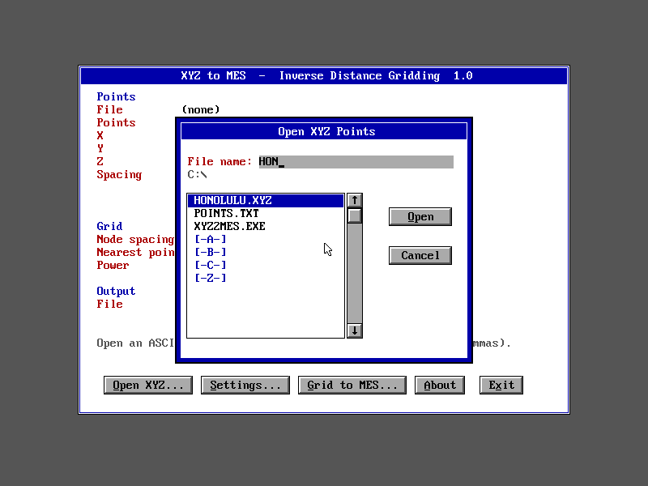
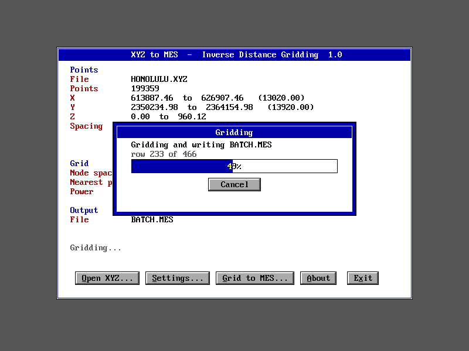
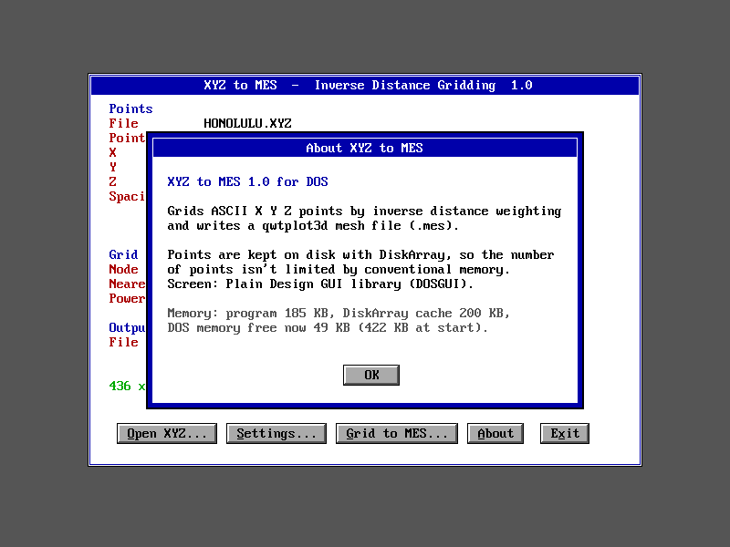
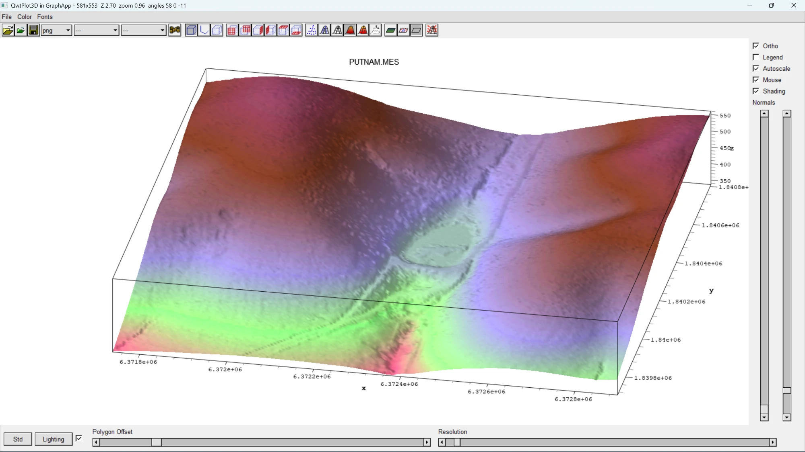

# XYZ2MES: gridding survey data in 640 KB

This example uses DiskArray with [DOSGUI](https://github.com/ferrellsl/DOSGUI) to get past the 640 KB limit of DOS and give the user a friendly GUI. It's a complete 16-bit DOS program, for an 8086 or later with a VGA card.

It reads ASCII X Y Z points, grids them by inverse distance weighting, and writes a [qwtplot3d](https://github.com/ferrellsl/Graphapp/tree/master/src/examples/qwtplot3d) mesh file (`.mes`).

The largest test file was 494,816 lidar points, 14 MB of text, about 22 times the memory DOS can give a program. Points that size can never sit in conventional memory, but here they don't have to.


## What it shows

**DiskArray holds the data.** The points are stored in `DiskArray<Pt>`, and the index of bucket starts in `DiskArray<long>`. The code reads and writes them with ordinary `a[i]` syntax. A cache of 4 KB pages keeps the ones in use in memory. Grid rows are written to the output as they are computed, so the grid isn't kept in memory either. Memory use stays the same however large the data gets: only disk space grows.

**DOSGUI is the face.** The program uses:
- a main panel at 800×600×16, or 640×480 on a plain VGA card
- the File Open and Save dialogs
- buttons with Alt or letter shortcuts
- a settings window with text fields
- a percent bar with Cancel, which the program reports progress through





**They share the memory.** The DiskArray cache sizes itself to whatever memory is free, and holds back 160 KB for the GUI. DOSGUI saves the screen under each window it opens, and an 800×600 dialog can take 90 KB for that. The About box reports the figures, measured from DOS while the program runs:

| | Honolulu run |
|---|---|
| The program itself (code, data, 32 KB stack) | 185 KB |
| DiskArray cache (50 pages) | 200 KB |
| Free for windows after loading | 139 KB |
| DOS memory free when the program started | 422 KB |



With less memory the cache simply gets smaller. The results are the same, but it runs more slowly.

## Results

The result for the Putnam Park bare-earth test file, shown in qwtplot3d:



**Putnam Park bare earth** (494,816 points, 14 MB, gridded at 2 ft to 581 × 553 nodes):
- In DOSBox-X at max cycles, reading and sorting took about 100 s and gridding about 200 s.
- At 3000 cycles, about a 286, reading takes much longer, while gridding stays tolerable.

**Honolulu** (199,359 points, 6 MB, a 30 m DEM, gridded at 30 to 436 × 466 nodes):
- Reading took about 25 s and gridding about 60 s at max cycles.

How the output was checked:
- **Honolulu:** every node is within 0.001 of an independent SciPy KD-tree IDW computation, which is the rounding of the output's three decimals.
- **Putnam:** the reference differs at 44 of the 321,293 nodes, all exact or near ties between the 8th and 9th nearest points.
- **DOS build vs a native build of the same engine:** they differ at 5 nodes in each file, by 0.001. The DOS build calculates in 80-bit x87 precision and the native build in 64-bit SSE.
- **Batch mode:** `/B` output was byte-identical to an interactive run.

DOSBox-X doesn't simulate disk seek times, and at max cycles it runs far faster than any 1990s PC. Treat the times as relative. The program hasn't been run on real hardware.

## Using it

1. **Open XYZ** (O). Each line holds x y z, separated by spaces, tabs, commas or semicolons. Lines without three numbers, such as headers, are skipped and counted.
2. **Settings** (S):
   - Node spacing in data units. It defaults to a round number near the average point spacing.
   - Nearest points, 1 to 32. The default is 8.
   - Power. The default is 2, giving the weight 1/d².
3. **Grid to MES** (G) asks for the output name and writes the grid.
   - Nodes fall on multiples of the spacing, and the grid covers the data's whole extent.
   - ESC or Cancel stops a run, and a canceled grid leaves no partial file.

Command line: `XYZ2MES [mode] [/B points.xyz grid.mes]`
- `mode` is a video mode in hex, such as `12` for 640×480 or `104` for 1024×768.
- `/B` opens and grids with the defaults, with no dialogs and no keys to press, then prints the result and returns to DOS. It's for batch files and testing.

While a file is open, the program keeps temporary files in the current directory, about 16 bytes per point. They are deleted on exit.

## How it works

- **Coordinates:** stored as floats relative to the first point, so state plane and UTM values keep their decimals.
- **Buckets:** the points are sorted into square buckets of about 8 points each, so a node reads only the buckets around it. Those buckets sit on nearby pages of the array file.
- **Two-pass sort:** the sort runs in two passes so that its writes stay in the cache:
  1. The first pass splits the points into bands of bucket rows.
  2. The second sorts within each band, which fits in the cache.

  Sorting straight into bucket order sends almost every write to a page that isn't cached. That was the bottleneck noted in the main README, and the two passes made sorting several times faster.
- **Nearest-point search:** the search reads rings of buckets around the node, and stops only when nothing outside them can be closer. The result is therefore the same as a full search of every point.

Two lessons from building it:
- **Stack checking:** Open Watcom's `-ox` includes `-s`, which turns stack checking off. When the GUI's calls sat on top of the gridding code, the 16 KB stack overflowed silently and DOSBox-X froze at random. The build uses `-obmiler` instead (`-ox` without `-s`) and a 32 KB stack.
- **Template instantiation:** in Open Watcom, a `delete` of a `DiskArray<T> *` placed before the template has been instantiated gives warning W546, and the destructor is skipped, so the array file is never closed. `xyz_unload()` is defined after the arrays are used.

## Building

You need Open Watcom (in `C:\WATCOM`, or set `WATCOM`) and a clone of [DOSGUI](https://github.com/ferrellsl/DOSGUI) next to this repository:

```
...\DiskArray\examples\xyz2mes     this example
...\DOSGUI\src                     DOSGUI
```

Run `build.bat`, or set `DOSGUI` to its `src` folder first. The output is `build16\xyz2mes.exe`. Building with `set XFLAGS=-dSHOTS` makes the screenshot build, which saves BMP files in `/B` mode; that's how the screenshots here were made.

`cli.cpp` is the engine without the screen. It builds natively, so the gridding can be checked on any system:

```
g++ -O2 -I../.. cli.cpp engine.cpp ../../dskarray.cpp -o cli
cli points.xyz grid.mes [spacing] [nearest] [power]
```

## Files

| File | Purpose |
|---|---|
| `xyz2mes.c` | The program and its screen (C, DOSGUI) |
| `engine.cpp`, `engine.h` | Reading, sorting and gridding (C++98, DiskArray), callable from C |
| `cli.cpp` | The engine without the screen, for testing |
| `build.bat` | The DOS build |
| `screenshots/` | The pictures above |
